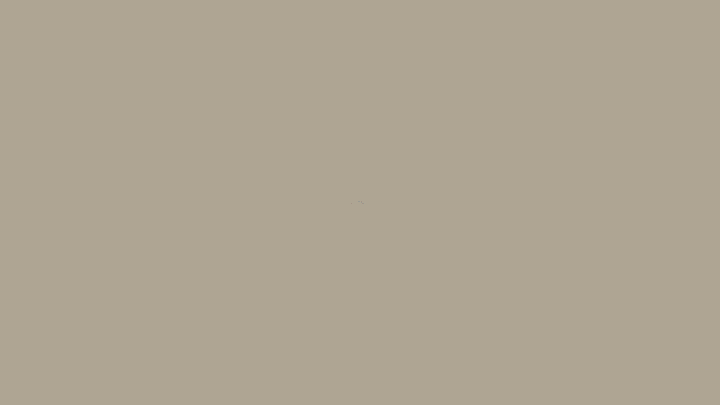
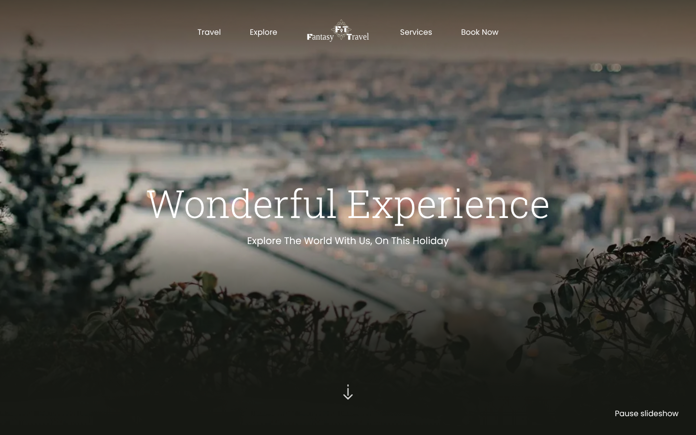
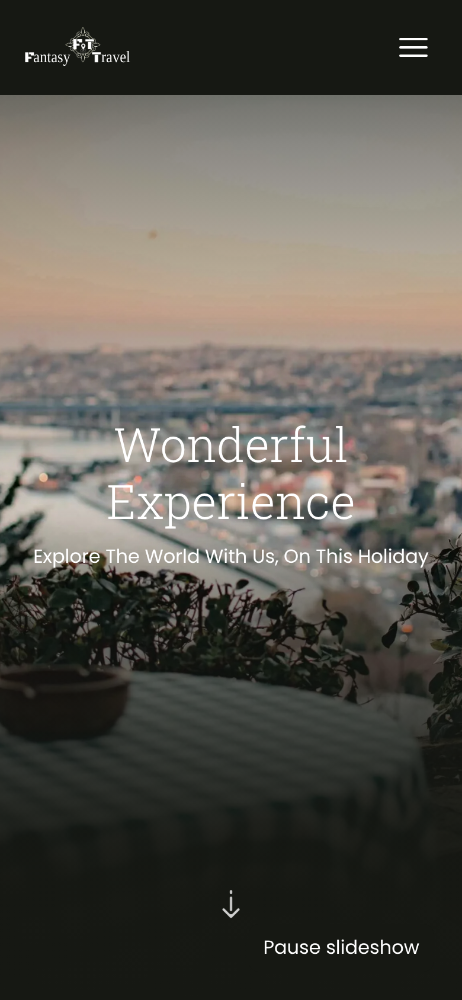
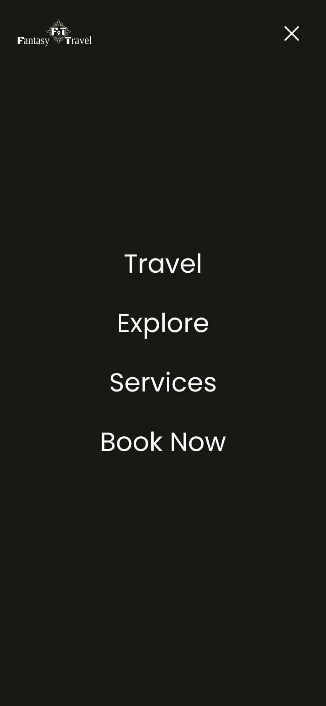
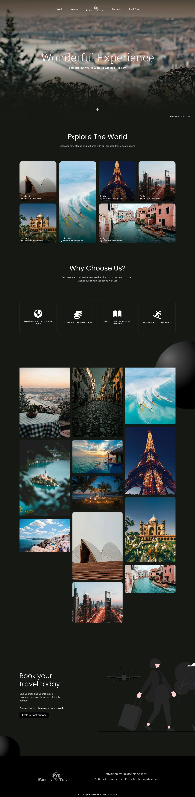
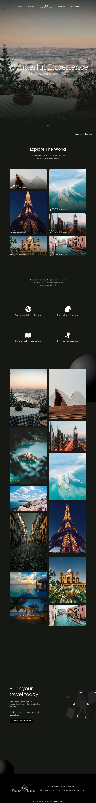
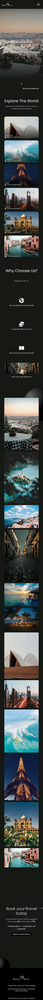
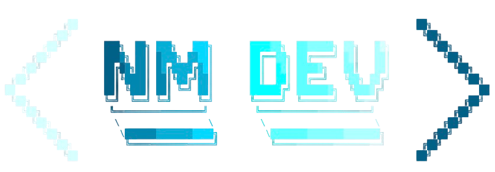

<a id="top"></a>

<div align="center">

  

  <h1>✈️ Fantasy Travel</h1>

  <h3>A responsive travel landing page built with HTML, CSS, and vanilla JavaScript.</h3>

  <p>
    <a href="https://nitzanm23.github.io/fantasy-travel/">
      
    </a>
  </p>

  <p>
    
    
    
    <a href="https://github.com/nitzanm23/fantasy-travel/actions/workflows/ci.yml">
      
    </a>
  </p>

</div>

<p align="center">
  
</p>

---

## 🎯 Overview

**Fantasy Travel** is a single-page landing page for a fictional travel brand, built as a portfolio project with semantic HTML, modular CSS, and vanilla JavaScript.

The visual base follows the Modern Web tutorial credited below. I extended it with a branded opening screen, BEM-structured CSS, an accessible mobile menu, and slideshow controls.

> **Demo scope:** A static presentation page with no backend, booking engine, payments, or API calls. Destination cards are informational, and the main call to action scrolls to the destinations.

---

## ✨ Features

- **Branded opening screen:** A three-second logo intro. Without JavaScript it never appears, and a CSS fallback reveals the page even if the script fails.
- **Hero slideshow:** A six-panel image wipe with a pause/resume button. It stops automatically when the tab is hidden or reduced motion is enabled.
- **Responsive layouts:** CSS Grid for destination cards, CSS columns for the photo gallery, and Flexbox for alignment, tested from 360px to 1440px.
- **Accessible mobile menu:** ARIA state kept in sync, Escape to close, focus returned to the toggle, and the rest of the page made `inert` while the menu is open.
- **Scroll reveals:** AOS animations that degrade safely: content stays visible if the library fails to load.

---

## 🧠 Technical Highlights

- **No broken frames in the slideshow:** The next image is decoded (`img.decode()`) before the wipe starts. A generation counter cancels in-flight transitions when the user pauses, so a stale timer can never swap the image.
- **Progressive enhancement:** JavaScript-dependent styles apply only once a script has added its class (`has-js`, `is-loading`, `aos-enabled`). With scripts disabled, the menu renders as a plain link row and all content is visible.
- **Motion preferences:** `prefers-reduced-motion` stops the slideshow and AOS. The loader's CSS failsafe timers are exempt, because they are timers rather than motion.
- **Design tokens:** Colors, spacing, motion, and z-index layers live in `tokens.css` as custom properties; components use BEM naming.
- **No third-party requests:** AOS and fonts are self-hosted, and the five icons ship as an inline SVG sprite instead of a full icon font.

---

## 🧰 Tech Stack

- **HTML5 & CSS3:** custom properties, BEM, Grid, Flexbox, CSS columns, media queries
- **Vanilla JavaScript:** no framework or build step
- **AOS 2.3.1:** scroll animations, self-hosted in `vendor/aos/`
- **Font Awesome Free 6.7.2:** five icons, inlined as an SVG sprite
- **Poppins & Roboto Slab:** self-hosted `.woff2` fonts in `vendor/fonts/`
- **GitHub Actions:** HTML validation, Lighthouse CI, and GitHub Pages deployment

---

## 📁 Project Structure

```text
fantasy-travel/
├── index.html
├── assets/
│   ├── icons/            # favicon
│   ├── images/           # photos, UI graphics, social preview image
│   └── logo/
├── styles/
│   ├── tokens.css        # design tokens (colors, spacing, motion, layers)
│   ├── reset.css         # browser defaults, focus ring, reduced motion
│   ├── index.css         # layout and components
│   └── page-loader.css   # opening screen and its fallbacks
├── scripts/
│   ├── page-loader.js    # opening-screen timer (runs before first paint)
│   └── app.js            # slideshow, navigation, AOS setup, footer year
├── vendor/               # self-hosted AOS and fonts, with license files
├── docs/                 # README screenshots, demo GIF, signatures
└── .github/              # CI workflow, html-validate and Lighthouse settings
```

---

## 🚀 Getting Started

### Run locally

Clone the repository, open a terminal in the project folder, and start a static server:

```bash
python3 -m http.server 8000
```

Then open `http://localhost:8000`. No `npm install` or build step is needed.

### CI & deployment

Every push and pull request runs [`ci.yml`](.github/workflows/ci.yml): `html-validate` checks the markup, and Lighthouse CI fails the run if Accessibility, Best Practices, or SEO drop below 95. Pushes to `main` that pass are deployed to GitHub Pages, publishing only the runtime files.

### Testing

Checked in Chrome at five widths (360–1440px), including keyboard-only navigation, reduced motion, and JavaScript disabled. Results: no console errors, 0 axe-core violations, and a Lighthouse Accessibility score of 100.

---

## 📸 Screenshots

<table>
  <tr>
    <td width="64%" valign="top"></td>
    <td width="18%" valign="top"></td>
    <td width="18%" valign="top"></td>
  </tr>
</table>

<details>
  <summary>Full-page captures (desktop, tablet, mobile)</summary>
  <br />
  
  <br /><br />
  
  
</details>

---

## 🔭 Possible Improvements

- Serve responsive image sizes (`srcset`) so phones download smaller photos.
- Use landscape-cropped hero images; the current portrait photos are cropped on wide screens.
- Test on Safari/iOS and Firefox, and with a screen reader.

---

## 🙏 Credits & License

- **Tutorial:** [Responsive Travel website using HTML, CSS and Javascript](https://dev.to/themodernweb/responsive-website-using-css-and-js-full-of-animations-3ico) by Modern Web, with starter files from [kunaal438/travel-one-page-website](https://github.com/kunaal438/travel-one-page-website).
- **Photos:** From the tutorial's starter files; their original sources are not documented there.
- **Libraries & fonts:** AOS (MIT), Font Awesome Free icons (CC BY 4.0), Poppins (OFL 1.1), and Roboto Slab (Apache 2.0). License files are in `vendor/`.
- **License:** My own code is released under the [MIT License](LICENSE). Third-party assets above keep their own terms.

---

## 👤 About Me

<div align="center">

  <h3>NM Dev · Nitzan Mizrachi</h3>

  <p>
    <a href="https://nm-dev.com">
      
    </a>
    <a href="https://www.linkedin.com/in/nitzan-mizrachi/">
      
    </a>
    <a href="mailto:nitzanm23@gmail.com">
      
    </a>
    <a href="https://github.com/nitzanm23">
      
    </a>
  </p>

  <table align="center">
    <tr>
      <td align="center">
        
      </td>
      <td align="center">
        
      </td>
    </tr>
  </table>

  <p><a href="#top">⬆ Back to top</a></p>

</div>
